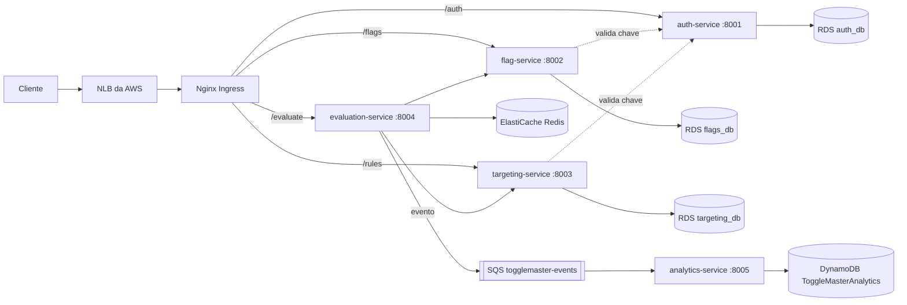

# ToggleMaster - Fase 2

Plataforma de *feature flags* composta por 5 microsserviços, empacotados em contêineres (Docker), publicados no Amazon ECR e executados em um cluster Kubernetes (Amazon EKS) com banco relacional (RDS), cache (ElastiCache), fila (SQS) e NoSQL (DynamoDB).

Projeto do Tech Challenge FIAP, Fase 2. Ambiente de execução: AWS Academy Learner Lab, região `us-east-1`.

## Sumário

- [Arquitetura](#arquitetura)
- [Microsserviços](#microsserviços)
- [Estrutura do repositório](#estrutura-do-repositório)
- [Executar localmente](#executar-localmente)
- [Infraestrutura na AWS](#infraestrutura-na-aws)
- [Deploy no Kubernetes](#deploy-no-kubernetes)
- [Rotas e teste ponta a ponta](#rotas-e-teste-ponta-a-ponta)
- [Escalabilidade (HPA)](#escalabilidade-hpa)
- [Boas práticas adotadas](#boas-práticas-adotadas)
- [Limitações conhecidas](#limitações-conhecidas)
- [Custos e limpeza](#custos-e-limpeza)

## Arquitetura



Cada serviço roda em seu próprio *namespace*. O `analytics-service` é um *worker* que consome a fila e não tem rota pública.

## Microsserviços

| Serviço | Linguagem | Porta | Namespace | Dependências |
| --- | --- | --- | --- | --- |
| `auth-service` | Go | 8001 | `auth` | PostgreSQL (`auth_db`) |
| `flag-service` | Python | 8002 | `flags` | PostgreSQL (`flags_db`), `auth-service` |
| `targeting-service` | Python | 8003 | `targeting` | PostgreSQL (`targeting_db`), `auth-service` |
| `evaluation-service` | Go | 8004 | `evaluation` | Redis, SQS, `flag-service`, `targeting-service` |
| `analytics-service` | Python | 8005 | `analytics` | SQS, DynamoDB |

## Estrutura do repositório

```text
.
├── auth-service/            # código, Dockerfile e db/init.sql
├── flag-service/
├── targeting-service/
├── evaluation-service/
├── analytics-service/
├── docker-compose.yml       # execução local
└── k8s/                     # manifestos Kubernetes
    ├── 00-namespaces.yaml
    ├── auth-service.yaml        # ConfigMap + Deployment + Service
    ├── flag-service.yaml
    ├── targeting-service.yaml
    ├── evaluation-service.yaml
    ├── analytics-service.yaml
    ├── ingress.yaml             # um Ingress por serviço, rotas por caminho
    └── hpa.yaml                 # HPA do evaluation e do analytics
```

Os **Secrets não ficam no repositório** (senhas, chaves e endpoints). Eles são criados direto no cluster com `kubectl create secret`, como mostrado abaixo.

## Executar localmente

```bash
docker compose up --build
```

A configuração dos serviços para uso local está no `docker-compose.yml`. Localmente o PostgreSQL é acessado sem SSL; na AWS as URLs de conexão usam `sslmode=require`.

## Infraestrutura na AWS

Criada manualmente pelo Console (o `eksctl create cluster` não é usado na opção AWS Academy).

| Recurso | Configuração |
| --- | --- |
| EKS | Cluster `togglemaster-eks`, *Custom configuration* com EKS Auto Mode desligado, role `LabRole`, endpoint público |
| Node group | `togglemaster-nodes`, role `LabRole`, Amazon Linux 2023, `t3.small`, mínimo 1, desejado 2, máximo 4 |
| ECR | 5 repositórios, um por serviço, imagens com a tag `v1` |
| RDS | 3 instâncias PostgreSQL independentes (`auth_db`, `flags_db`, `targeting_db`), privadas, na VPC padrão |
| ElastiCache | 1 cluster Redis de um nó (`togglemaster-redis`), sem TLS |
| DynamoDB | Tabela `ToggleMasterAnalytics`, chave de partição `event_id` (String), modo sob demanda |
| SQS | Fila Standard `togglemaster-events` |
| Rede | Security group que libera as portas 5432 (PostgreSQL) e 6379 (Redis) para o CIDR da VPC |

Os pods acessam SQS e DynamoDB com a `LabRole` dos nós. Para isso é necessário subir o *hop limit* do IMDSv2 para 2 em cada nó:

```bash
aws ec2 modify-instance-metadata-options --instance-id <ID_DA_INSTANCIA> \
  --http-put-response-hop-limit 2 --http-endpoint enabled
```

Nós novos voltam ao valor padrão: repita o comando quando o node group trocar ou religar instâncias.

### Imagens

```bash
ECR=<ACCOUNT_ID>.dkr.ecr.us-east-1.amazonaws.com
aws ecr get-login-password --region us-east-1 | docker login --username AWS --password-stdin $ECR
for s in auth-service flag-service targeting-service evaluation-service analytics-service; do
  docker build --platform linux/amd64 -t $ECR/$s:v1 ./$s && docker push $ECR/$s:v1
done
```

### Tabelas

Cada serviço com PostgreSQL tem um `db/init.sql` (com `IF NOT EXISTS`, seguro para repetir). Como os bancos são privados, eles são executados por um pod `psql` temporário dentro do cluster.

## Deploy no Kubernetes

### 1. Componentes do cluster

```bash
aws eks update-kubeconfig --region us-east-1 --name togglemaster-eks

# Metrics Server (necessário para o HPA)
kubectl apply -f https://github.com/kubernetes-sigs/metrics-server/releases/latest/download/components.yaml

# Nginx Ingress Controller (cria um Network Load Balancer)
kubectl apply -f https://raw.githubusercontent.com/kubernetes/ingress-nginx/controller-v1.15.1/deploy/static/provider/aws/deploy.yaml
kubectl wait --namespace ingress-nginx --for=condition=ready pod \
  --selector=app.kubernetes.io/component=controller --timeout=240s
```

### 2. Namespaces e Secrets

```bash
kubectl apply -f k8s/00-namespaces.yaml

kubectl create secret generic auth-secret -n auth \
  --from-literal=DATABASE_URL="postgres://postgres:<SENHA>@<ENDPOINT_AUTH_DB>:5432/auth_db?sslmode=require" \
  --from-literal=MASTER_KEY="<CHAVE_MESTRA>"

kubectl create secret generic flags-secret -n flags \
  --from-literal=DATABASE_URL="postgres://postgres:<SENHA>@<ENDPOINT_FLAGS_DB>:5432/flags_db?sslmode=require"

kubectl create secret generic targeting-secret -n targeting \
  --from-literal=DATABASE_URL="postgres://postgres:<SENHA>@<ENDPOINT_TARGETING_DB>:5432/targeting_db?sslmode=require"

kubectl create secret generic analytics-secret -n analytics \
  --from-literal=AWS_SQS_URL="<URL_DA_FILA_SQS>"
```

O Kubernetes grava os valores em base64 no campo `data` do Secret. Use uma senha de banco sem os caracteres `@ / : ? # '`, porque ela vai dentro da URL.

### 3. Serviços

Os manifestos usam o marcador `__ECR__` no campo `image`. Troque-o pelo seu registro ao aplicar:

```bash
ECR=<ACCOUNT_ID>.dkr.ecr.us-east-1.amazonaws.com
for s in auth-service flag-service targeting-service; do
  sed "s#__ECR__#$ECR#g" k8s/$s.yaml | kubectl apply -f -
done
kubectl rollout status deployment/auth-service -n auth --timeout=180s
```

O `evaluation-service` precisa de uma chave de API válida do `auth-service`. Com o auth no ar, gere a chave (ela só aparece nesta resposta, o banco guarda apenas o hash):

```bash
kubectl run curl-key --rm -i --restart=Never --image=curlimages/curl -- \
  -s -X POST http://auth-service.auth.svc.cluster.local:8001/admin/keys \
  -H "Authorization: Bearer <CHAVE_MESTRA>" -H "Content-Type: application/json" \
  -d '{"name":"evaluation"}'
```

Anote o valor `tm_key_...` e crie o Secret do evaluation:

```bash
kubectl create secret generic evaluation-secret -n evaluation \
  --from-literal=REDIS_URL="redis://<ENDPOINT_REDIS>:6379" \
  --from-literal=AWS_SQS_URL="<URL_DA_FILA_SQS>" \
  --from-literal=SERVICE_API_KEY="<tm_key_...>"

for s in evaluation-service analytics-service; do
  sed "s#__ECR__#$ECR#g" k8s/$s.yaml | kubectl apply -f -
done
```

### 4. Ingress e HPA

```bash
kubectl apply -f k8s/ingress.yaml
kubectl apply -f k8s/hpa.yaml
kubectl get svc ingress-nginx-controller -n ingress-nginx   # endereço público do load balancer
```

### Variáveis de ambiente por serviço

| Serviço | ConfigMap | Secret |
| --- | --- | --- |
| auth | `PORT` | `DATABASE_URL`, `MASTER_KEY` |
| flag | `PORT`, `AUTH_SERVICE_URL` | `DATABASE_URL` |
| targeting | `PORT`, `AUTH_SERVICE_URL` | `DATABASE_URL` |
| evaluation | `PORT`, `FLAG_SERVICE_URL`, `TARGETING_SERVICE_URL`, `AWS_REGION` | `REDIS_URL`, `AWS_SQS_URL`, `SERVICE_API_KEY` |
| analytics | `PORT`, `AWS_REGION`, `AWS_DYNAMODB_TABLE` | `AWS_SQS_URL` |

Como os serviços estão em namespaces diferentes, os endereços internos incluem o namespace, por exemplo `http://auth-service.auth.svc.cluster.local:8001`.

## Rotas e teste ponta a ponta

| Caminho público | Serviço |
| --- | --- |
| `/auth/...` (o prefixo `/auth` é removido antes de chegar ao serviço) | auth-service |
| `/flags` | flag-service |
| `/rules` | targeting-service |
| `/evaluate` | evaluation-service |

```bash
LB=<endereco-do-load-balancer>
KEY=<tm_key_...>

curl -i http://$LB/auth/health

curl -X POST http://$LB/flags -H "Authorization: Bearer $KEY" -H "Content-Type: application/json" \
  -d '{"name":"enable-new-checkout","description":"teste","is_enabled":true}'

curl -X POST http://$LB/rules -H "Authorization: Bearer $KEY" -H "Content-Type: application/json" \
  -d '{"flag_name":"enable-new-checkout","is_enabled":true,"rules":{"type":"PERCENTAGE","value":100}}'

curl "http://$LB/evaluate?user_id=user-123&flag_name=enable-new-checkout"
```

O esperado é `200` no health e `"result": true` na avaliação (a segunda chamada vem do cache Redis). Cada avaliação envia um evento ao SQS; o `analytics-service` o consome e grava na tabela DynamoDB, onde os itens podem ser conferidos:

```bash
aws dynamodb scan --table-name ToggleMasterAnalytics --region us-east-1 --max-items 3
```

## Escalabilidade (HPA)

Dois `HorizontalPodAutoscaler` por utilização média de CPU (alvo de 70%), conforme o requisito da Opção A (AWS Academy):

| HPA | Alvo | Mínimo | Máximo |
| --- | --- | --- | --- |
| `evaluation-hpa` | `evaluation-service` | 1 | 4 |
| `analytics-hpa` | `analytics-service` | 1 | 3 |

Para o `analytics-service`, o HPA por CPU é o *workaround* do Academy: quando a fila SQS enche, o serviço processa mais mensagens, a CPU sobe e o HPA adiciona pods. O Metrics Server precisa estar rodando, e os Deployments têm `requests` de CPU, que servem de base para o cálculo.

Teste de carga (gera requisições contínuas contra o evaluation, por dentro do cluster):

```bash
URL='http://evaluation-service.evaluation.svc.cluster.local:8004/evaluate?user_id=u1&flag_name=enable-new-checkout'
for i in 1 2 3; do
  kubectl run load-$i -n evaluation --image=busybox:1.36 --restart=Never -- \
    /bin/sh -c "while true; do wget -q -O- '$URL' >/dev/null; done"
done
kubectl get hpa -n evaluation -w
kubectl delete pod load-1 load-2 load-3 -n evaluation
```

## Boas práticas adotadas

- Aplicações separadas por **namespace**.
- **Requests e limits** de CPU e memória em todos os Deployments.
- **Readiness e liveness probes** em `/health`.
- Services do tipo **ClusterIP**; acesso externo somente pelo Ingress.
- **Secrets** para senhas, chaves e endpoints, criados fora do repositório e armazenados em base64 pelo Kubernetes.
- **ConfigMaps** para portas, região e URLs de serviços internos.
- Imagens com **tag fixa** (`v1`) em vez de `latest`.

## Limitações conhecidas

- O repositório do Ingress NGINX foi arquivado em 24/03/2026 e não recebe mais correções de segurança. O enunciado exige esse controller, então ele é usado fixando a versão `v1.15.1`. Em um ambiente real, planeje a migração para outro controller.
- No Learner Lab, os nós do node group às vezes não entram no cluster. O log de boot das instâncias mostrou o `nodeadm` recebendo `explicit deny in a service control policy` em `ec2:DescribeInstances`, uma política da organização do Academy. Recriar o node group resolveu em algumas sessões; a causa da intermitência não foi identificada.
- O Redis é criado sem TLS (`redis://`), e cada `t3.small` aceita no máximo 11 pods.

## Custos e limpeza

EKS (plano de controle), RDS, ElastiCache e o load balancer cobram por hora enquanto existirem, e o orçamento do Learner Lab é limitado. Para pausar sem apagar, reduza o node group para 0 e pare os RDS. Para encerrar, apague nesta ordem: Ingress e Ingress NGINX (remove o load balancer), node group, cluster, RDS, ElastiCache, tabela DynamoDB, fila SQS, repositórios ECR e, por último, o security group.


